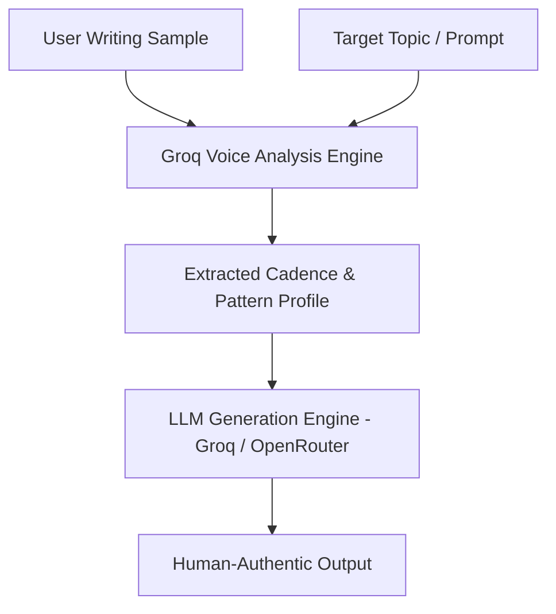

<div align="center">

# Pryzmira

**Syntactic Voice Cloning & Personal Writing AI Engine**

[](https://nextjs.org)
[](https://groq.com)
[](https://supabase.com)
[](https://github.com/Diwak4r)

</div>

---

### Overview

**Pryzmira** is a specialized voice synthesis platform designed to eliminate robotic AI writing signatures. By analyzing a single writing sample provided by the user, Pryzmira extracts unique syntactic patterns, cadence, and vocabulary choices to generate text that authentically sounds like the author—not an LLM template.

### Voice Synthesis Pipeline



### Stack Architecture

| Layer | Technology |
| :--- | :--- |
| **Frontend & Routing** | Next.js 16 (App Router), React 19, Tailwind CSS |
| **Primary AI Engine** | Groq Llama 3 / Mixtral Inference API |
| **Fallback AI Engine** | OpenRouter Gateway |
| **Database & Auth** | Supabase (User Sessions & Storage) |

### Development Setup

```bash
# Clone & install dependencies
cd next-web
npm install

# Run local development server
npm run dev
```

#### Required Environment Variables (`.env.local`)

```env
GROQ_API_KEY=your_groq_api_key
OPENROUTER_API_KEY=your_openrouter_api_key
NEXT_PUBLIC_SUPABASE_URL=your_supabase_url
NEXT_PUBLIC_SUPABASE_ANON_KEY=your_supabase_anon_key
SUPABASE_SERVICE_ROLE_KEY=your_service_role_key
```

---

<div align="center">
  <sub>Developed by <a href="https://github.com/Diwak4r">Diwakar Yadav</a></sub>
</div>
