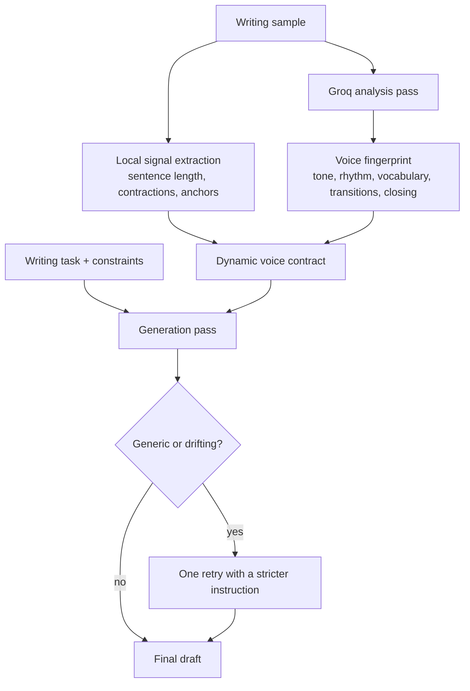

<div align="center">

# Pryzmira

**Voice-matched writing engine + a live gallery of builds made with AI models**

[](https://nextjs.org)
[](https://groq.com)
[](https://supabase.com)
[](https://vitest.dev)
[](https://github.com/Diwak4r)

</div>

---

## What Pryzmira is

Two things that share one codebase:

1. **A voice engine.** Paste one writing sample. Pryzmira measures how you write, builds a voice contract from those measurements, and drafts new text against it - then retries once if the draft drifts into generic assistant prose.
2. **A build gallery** at `/builds`. A live view of what people are shipping with Claude, GPT, Gemini, Llama, FLUX and friends - pulled from **X (Twitter)** and **GitHub**, merged with a curated starter set. Every card names the model and links to its source. Any card can hand a ready-made writing task to the voice engine.

There is also a real guide at `/guide`: a capability scan, recipes, source setup, environment variables, troubleshooting, and FAQ. It is generated from `src/lib/guide.ts`, and a unit test fails if the docs drift from the code.

### Voice engine pipeline



### Build gallery pipeline

```mermaid
graph LR
    X[X API v2<br/>recent search] --> XAdapter[X adapter]
    GH[GitHub search API] --> GHAdapter[GitHub adapter]
    XAdapter --> Merge[Cache + dedupe]
    GHAdapter --> Merge
    Curated[Curated picks<br/>shipped with the app] --> Merge
    Merge --> API[GET /api/builds]
    API --> Gallery[/builds gallery]
    Gallery --> Desk[Write about it -> /?task=...]
```

## Capability scan

| Capability | Status | Where | Needs |
| :--- | :--- | :--- | :--- |
| Voice fingerprint analysis (6 dimensions + 5-7 style markers) | Stable | `/` | Model key or demo mode |
| Voice-matched drafting with anti-generic retry | Stable | `/`, `/desk` | Model key or demo mode |
| Refine loop (4 quick chips + free-form instructions) | Stable | `/desk` | An existing draft |
| Save profiles and history | Stable | `/desk`, `/api/voice/save-current` | Sign in |
| Email/password + Google OAuth (PKCE, http-only cookies) | Stable | `/api/voice/auth/*` | Supabase |
| Quotas: 5/hour anonymous, 20/day signed in | Stable | Generate + refine routes | Supabase for shared counters |
| Provider fallback chain (Groq -> DashScope -> OpenRouter) | Stable | `src/lib/voiceService.ts` | At least one key |
| Build gallery with search, model/vendor filters, trending sort | New | `/builds` | Nothing |
| Live X feed (v2 recent search, 5 min cache) | Needs key | `src/lib/builds/sources/x.ts` | `X_BEARER_TOKEN` |
| Live GitHub feed (repo search, 10 min cache) | Beta | `src/lib/builds/sources/github.ts` | Optional `GITHUB_TOKEN` |
| Demo mode (local, clearly labelled scaffold) | New | `src/lib/demoEngine.ts` | Automatic |
| Unit test suite (222 tests, 13 files) | New | `src/lib/**/__tests__` | `npm test` |
| In-app guide with docs-sync tests | New | `/guide` | Nothing |

## Quickstart

```bash
cd next-web
npm install

cp .env.local.example .env.local   # fill in what you need; everything is optional
npm run dev
```

Open <http://localhost:3000>. Without any model key the app starts in **demo mode**: you get a local, clearly labelled scaffold so the whole flow can be walked. Add a provider key for real generation.

### Environment variables

| Variable | Required | Purpose |
| :--- | :--- | :--- |
| `GROQ_API_KEY` | For real generation | Primary model provider |
| `GROQ_ANALYZE_MODEL` / `GROQ_GENERATE_MODEL` | Optional | Override the default `llama-3.3-70b-versatile` |
| `DASHSCOPE_API_KEY` | Optional | Second fallback provider |
| `OPENROUTER_API_KEY` | Optional | Final fallback provider |
| `NEXT_PUBLIC_SUPABASE_URL` | For accounts | Supabase project URL |
| `NEXT_PUBLIC_SUPABASE_ANON_KEY` | For accounts | Public auth key |
| `SUPABASE_SERVICE_ROLE_KEY` | For accounts | Server-only storage and quota key |
| `NEXT_PUBLIC_APP_URL` | Recommended in production | Trusted origin for auth redirects |
| `X_BEARER_TOKEN` | Optional | Enables the live X feed in `/builds` |
| `GITHUB_TOKEN` | Optional | Raises GitHub search rate limits |
| `PRYZMIRA_DISABLE_GITHUB_FEED` | Optional | Set `true` to skip GitHub |
| `PRYZMIRA_DEMO_MODE` | Optional | `true` forces demo mode, `false` disables auto-fallback |

`SUPABASE_SERVICE_ROLE_KEY` must never be exposed to the browser. Run `next-web/supabase/voice_schema.sql` once to create the tables and indexes.

## Testing

The suite runs on Vitest with no network access - provider calls, X, and GitHub are mocked at the `fetch` boundary.

```bash
npm test          # 222 unit tests across 13 files
npm run typecheck # tsc --noEmit
npm run lint      # eslint
npm run verify    # all three, in order
```

| File | Covers |
| :--- | :--- |
| `voice.test.ts` | Validation, word counts, previews, refine input, truncation |
| `voiceService.test.ts` | Analysis parsing, prompt contract, generic retry, provider fallbacks |
| `voiceAuth.test.ts` | Redirect sanitization, PKCE generation, OAuth URL building |
| `voiceRateLimit.test.ts` | Per-email and per-IP windows, retry timing, hashed buckets |
| `voiceStorage.test.ts` | Quota enforcement, profile and generation persistence |
| `voiceRequestError.test.ts` | Engine failure detection and user-facing normalization |
| `builds/normalize.test.ts` | Model detection, classification, filtering, sorting, dedupe |
| `builds/sources.test.ts` | X and GitHub request building plus response mapping |
| `builds/feed.test.ts` | Feed merging, fallbacks, caching, source statuses |
| `builds/catalog.test.ts` | Catalog and curated-data integrity |
| `builds/route.test.ts` | `GET /api/builds` filters, sorting, limits, caching headers |
| `guide.test.ts` | Docs stay in sync with routes, env vars, and test files |
| `demoEngine.test.ts` | Deterministic local drafts and demo-mode detection |

Writing the tests surfaced two real bugs in the voice engine, both fixed: a missing `GROQ_API_KEY` was swallowed and reported as a network outage, and raw provider errors were returned to users instead of being normalized.

## Project layout

```
next-web/
├─ src/app/
│  ├─ page.tsx                 # writer
│  ├─ desk/page.tsx            # refine + history
│  ├─ builds/page.tsx          # build gallery
│  ├─ guide/page.tsx           # documentation
│  └─ api/
│     ├─ builds/route.ts       # gallery feed (filters, sort, limit)
│     └─ voice/                # generate, refine, history, save, auth, health
├─ src/lib/
│  ├─ voice.ts                 # shared types + validation
│  ├─ voiceService.ts          # analysis + generation + fallbacks
│  ├─ voiceStorage.ts          # Supabase or local persistence + quotas
│  ├─ voiceAuth.ts             # Supabase auth, PKCE, redirect safety
│  ├─ demoEngine.ts            # local demo draft engine
│  ├─ guide.ts                 # guide content (single source of truth)
│  └─ builds/
│     ├─ catalog.ts            # models, tools, categories
│     ├─ normalize.ts          # detection, filtering, ranking
│     ├─ curated.ts            # hand-picked starter builds
│     ├─ feed.ts               # merge + cache live and curated
│     └─ sources/              # X and GitHub adapters
└─ src/views/                  # client views (writer, desk, gallery, guide)
```

## Adding a build source

Write an adapter that returns `AiBuild[]` and register it in `src/lib/builds/feed.ts`. Every card, filter, and test helper works automatically because they only depend on the shared type. The guide has a worked example at `/guide#builds`.

## Honest limits

- **Demo mode is not AI.** It composes a scaffold from your sample and leaves bracketed placeholders. It exists so the product works without keys, and the UI labels it everywhere.
- **No browsing, no fact-checking.** The voice engine only uses your sample, task, and instructions.
- **Curated picks do not invent launch dates or metrics.** They use the catalog date and only list models the team has publicly said they build on. Live cards carry real post and repo metrics.
- **X attribution needs a token.** Without `X_BEARER_TOKEN` the gallery shows GitHub plus curated picks and says so in the source pills.
- **Quotas fail closed.** If the quota service is unreachable, generation is denied rather than allowed through.

---

<div align="center">
  <sub>Developed by <a href="https://github.com/Diwak4r">Diwakar Yadav</a> - <a href="https://github.com/Diwak4r/Pryzmira">source</a></sub>
</div>
